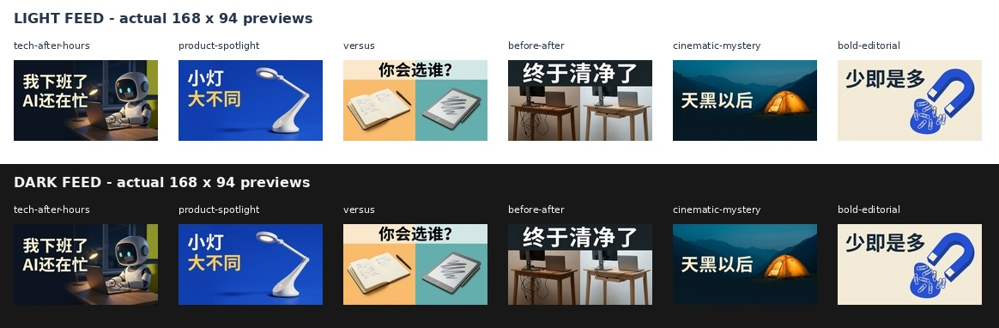

# AI YouTube Thumbnail Generator — live validation

**Date:** 2026-11-10 UTC. **Status:** six template families produced usable final
examples after the bounded fixes below. This is native Okou image-generation
validation, not an upstream app/MCP test and not a CTR or retention experiment.


## What is included

- [Skill entry point](../../ai-youtube-thumbnail-generator/SKILL.md), six portable
  art directions, six editable JSON briefs, prompt compiler and raster exporter.
- [Pinned provenance and source-selection decisions](../../ai-youtube-thumbnail-generator/UPSTREAM.md),
  with five complete upstream MIT notices. The 27,442-star baoyu and 5,378-star
  Jake repositories supplied cover grammar and supporting packaging guidance
  respectively; repository stars are not skill-specific or performance evidence.
- Marketplace registration and an offline CI job. No image API is called by CI.
- Actual saved prompts, every exported candidate, 168×94 previews and the
  credential-free [machine-readable run record](validation.json).

## Actual execution

| Item | Observed |
| --- | --- |
| Backend | `okou generate image --provider built-in ... --wait --json` |
| Actual model returned | `fal-ai/nano-banana-2` |
| Requested / returned geometry | 1280×720 / 1376×768 |
| Final delivery geometry | Exact 1280×720 JPEG after slight centered crop and downsample |
| Calls | 10 text-to-image + 1 image-to-image edit = 11 completed calls |
| Provider-reported credits | 880 total, 80 per completed call |
| Concurrency / retries | At most 3 concurrent calls; no automatic retries or uncertain resubmissions |
| Offline tests | 27/27 pass, Python 3.12.3, Pillow 12.3.0 |
| Skill metadata | Official skill-creator `quick_validate.py`: valid |
| Generation boundaries | No upstream code, NanoThumbnail MCP, Gemini web, YouTube upload, provider switch or new account connection |

All six template families were rendered in the first round. Four affected cases
were rendered again after correcting a common layout instruction. The cinematic
and editorial candidates were already usable and were not regenerated. Their
saved prompts retain the first-round wording. One before/after candidate then
received one narrowly scoped model edit to remove unrequested brand marks.
Later compiler robustness changes (literal slashes, no-text handling and export
error cases) were checked offline; the exact prompts actually sent for every
image remain versioned below rather than being overwritten to match later code.

## Selected final outputs

All six final images decode, are 1280×720 JPEG and below the conservative
2,000,000-byte cap. Full-size and mobile inspections checked text spelling,
focal-point clarity, margins, content truth and the lower-right quiet area.
The subjects are generic, fictional examples, not likeness/reference-fidelity
benchmarks or evidence that a real video achieved these outcomes.

| Template | Final image | Exact generation prompt | Bytes | Visual inspection |
| --- | --- | --- | ---: | --- |
| Tech / after hours | [JPEG](images/tech-after-hours-v2.jpg) | [v2 prompt](prompts/tech-after-hours-v2.txt) | 173,747 | Chinese copy readable; one working robot; no added corner marker |
| Product spotlight | [JPEG](images/product-spotlight-v2.jpg) | [v2 prompt](prompts/product-spotlight-v2.txt) | 133,176 | Generic lamp silhouette and short text readable; no corner box |
| Versus | [JPEG](images/versus-v2.jpg) | [v2 prompt](prompts/versus-v2.txt) | 159,191 | Clear paired choices and exact headline; no VS or corner badge added |
| Before / after | [JPEG](images/before-after-v3-edit.jpg) | [v2 base](prompts/before-after-v2.txt), then [one edit](prompts/before-after-v3-edit.txt) | 198,710 | Same desk/devices and readable change; unrequested laptop logos removed |
| Cinematic mystery | [JPEG](images/cinematic-mystery.jpg) | [initial prompt](prompts/cinematic-mystery.txt) | 144,756 | Warm tent remains visible against dark landscape; short copy readable |
| Bold editorial | [JPEG](images/bold-editorial.jpg) | [initial prompt](prompts/bold-editorial.txt) | 148,103 | Magnet metaphor, restrained palette and exact headline readable |

Non-blocking variation: the editorial prompt requested a perfectly aligned line
of paper clips; the model grouped them instead. The focus metaphor remains
readable, but this example does not establish exact geometric obedience.

### Actual-size mobile inspection

The following sheet places the delivered 168×94 previews on both light and dark
backgrounds without enlarging them. Open the original sheet to inspect at 1:1.



## Failures were retained, not hidden

1. **Four first-round layout-marker failures:** the phrase specifying a measured
   lower-right area “for the duration badge” caused the model to draw a corner
   placeholder; the tech candidate even printed `18%`. A technical export pass
   alone would have missed this.
   - [Tech first candidate](images/tech-after-hours.jpg)
   - [Product first candidate](images/product-spotlight.jpg)
   - [Versus first candidate](images/versus.jpg)
   - [Before/after first candidate](images/before-after.jpg)
2. **Fix:** make the quiet corner natural scene content, explicitly classify
   layout guidance as non-visible instructions, and forbid added interface
   badges/placeholder guides. Only the four affected examples were re-rendered.
3. **Before/after second candidate:** model-created laptop brand marks remained
   despite a generic-product brief. [That candidate](images/before-after-v2.jpg)
   was rejected. One real image-to-image edit removed only the marks; the source
   generation relationship is recorded in `validation.json`. No local bitmap text
   patch or invented reference-image test was used.
4. **Offline code review fixes:** preserve literal `A/B` and `24/7` copy, make the
   no-text editorial direction conditional, composite grayscale alpha correctly,
   roll back partial exports without deleting raced-in files, require JPEG for
   final validation, handle Pillow pixel-limit errors and keep the list command's
   exit path valid. Regression tests cover each issue, along with bad inputs,
   aspect mismatch, corrupt images, no-upscale
   and no-overwrite behavior.

## Reproduce the package path

From the repository root, use an isolated environment:

```bash
python3 -m venv /tmp/thumbnail-env
/tmp/thumbnail-env/bin/python -m pip install -r ai-youtube-thumbnail-generator/requirements.txt
/tmp/thumbnail-env/bin/python -m unittest discover \
  -s ai-youtube-thumbnail-generator/scripts -p 'test_*.py' -v
python3 ai-youtube-thumbnail-generator/scripts/thumbnail.py list
python3 ai-youtube-thumbnail-generator/scripts/thumbnail.py compile \
  --brief ai-youtube-thumbnail-generator/templates/examples/tech-after-hours.json \
  --out /tmp/new-thumbnail-prompt.txt
```

The compiler writes only a prompt. Follow the skill's current backend instructions
to run a real generation, download it, export it and inspect it. Use a new output
path for each attempt. Native generation is billed and not deterministic; the
model actually available depends on user Settings. Matching a saved prompt does
not guarantee identical pixels.

`validation.json` records actual generation IDs, modes, returned model/geometry,
credits, raw/output/prompt SHA-256 values and selected/rejected state. Private
artifact URLs, signed links, account IDs and credentials are deliberately absent.
Published JPEGs are delivery derivatives; raw source images and full receipts
were retained in the task workspace, not duplicated into the runtime skill.

## Not established by this run

- Audience click-through, watch time, retention, statistical confidence or a
  universally best style.
- Other languages beyond these Simplified Chinese image examples; the compiler
  accepts multilingual copy, but rendering must still be reviewed per request.
- Real-person identity, real-product reference fidelity, or pixel-perfect A/B
  preservation. The single logo-removal edit is not a general fidelity benchmark.
- Any upstream MCP/app, provider adapter, upload integration or analytics model.
- Unlimited prompt reliability: the first-round failures are precisely why
  delivered-image inspection is part of the skill, not an optional receipt check.
